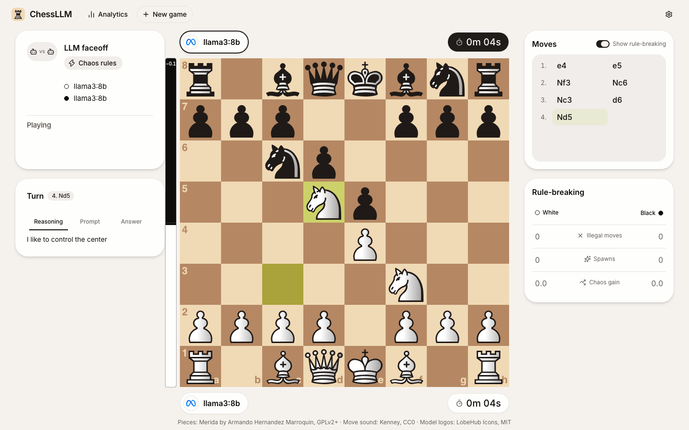
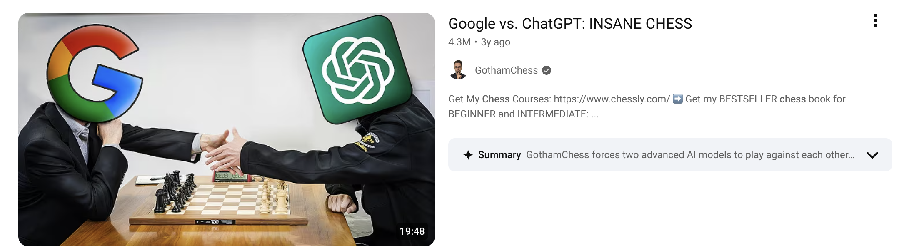
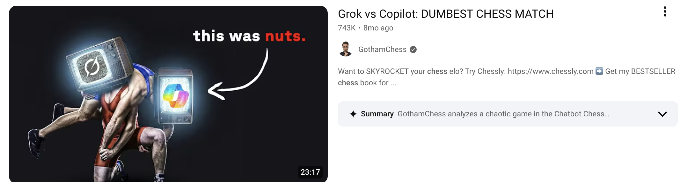
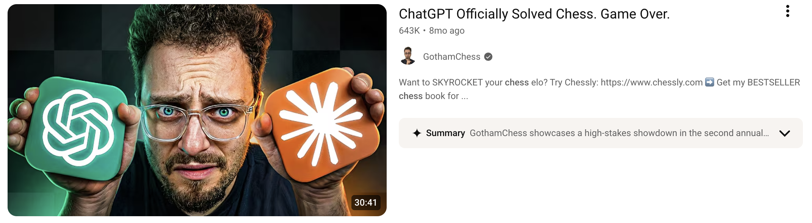

# ChessLLM

Play chess against local LLMs, watch how they play, and have them play each other.



## What is it?

- **Play an LLM.** Take on a small local model (through [Ollama](https://ollama.com)) in the browser.
- **See how LLMs play.** Every move and every attempt is logged, illegal ones included, and each game is analysed with Stockfish and Maia-2.
- **Have local LLMs play each other.** Pit two models against each other in a faceoff, or against chess engines of known strength, and see them ranked.

## Why?





I watched [GothamChess](https://www.youtube.com/@GothamChess)'s LLM faceoff videos (*Google vs. ChatGPT: INSANE CHESS*, *Grok vs Copilot: DUMBEST CHESS MATCH*, *ChatGPT Officially Solved Chess. Game Over.*) and was surprised by how often the models played illegal moves. That made me wonder how small local models compare, and how they do when they compete.

## What's in it for you?

- A fun game against an opponent that might move its bishop like a knight
- A way to compare local LLMs against each other and against engines
- LLM-vs-LLM games to sit back and watch

## Run it

You need Python with [uv](https://docs.astral.sh/uv/), Node with pnpm, and Ollama with `qwen3.5:9b` installed.

```sh
cd frontend && pnpm install && pnpm build && cd ..
uv run chessllm
```

Then open http://127.0.0.1:8000.

Faceoffs, engine matches, analysis and the tests are covered in [docs/development.md](docs/development.md).
