# Tools for trying out and iterating on the system prompts

Research date: 2026-10-19. Scope: tools, interfaces and libraries for editing ChessLLM's system prompts, running them against the local Ollama models (qwen3.5:9b, llama3:8b, gemma3:12b), comparing variants side by side, and scoring them in bulk on chess positions. Also: where prompt editing could live in ChessLLM.

Labels used below:
- **[Source]** means the claim is stated in the linked primary source (official docs, GitHub README or source, licence file).
- **[Inference]** means it is my reading or extrapolation, not something the source states.
- **[Repo]** means it is read from this repository's code.

Repo facts (stars, licence, latest release) were read from the GitHub API on 2026-10-19.

## TL;DR

- **The best match for bulk evaluation is promptfoo.** [Source] It has a native Ollama provider with `think` and `format` (JSON schema) options. Test cases can be loaded from CSV/JSONL or generated by a Python function. Its assertions can be Python functions, so "is the move legal" can be checked with python-chess. `promptfoo view` then shows a prompts × test cases matrix ([Ollama provider](https://www.promptfoo.dev/docs/providers/ollama/), [Python assertions](https://www.promptfoo.dev/docs/configuration/expected-outputs/python/), [test cases](https://www.promptfoo.dev/docs/configuration/test-cases/)). It is MIT licensed, but it is a Node CLI (Node ≥ 22.22) ([install](https://www.promptfoo.dev/docs/installation/)). OpenAI agreed to acquire it in March 2026 and committed to keep it open source ([OpenAI](https://openai.com/index/openai-to-acquire-promptfoo/), [promptfoo blog](https://www.promptfoo.dev/blog/promptfoo-joining-openai/)).
  - [Inference] With a **Python provider** that calls `chessllm.prompt.turn_messages` and `OllamaPlayer`, promptfoo tests exactly the request ChessLLM sends: thinking, schema, enum under Enforced decoding, and sampling.
- **For visual side-by-side tinkering, ChainForge is the best fit.** [Source] It is pip-installable, MIT licensed, talks to Ollama, and has Tabular Data inputs and Python evaluator nodes ([README](https://github.com/ianarawjo/ChainForge)).
  - [Source] Its Ollama settings have `system_msg` and a `format` JSON schema. They have no `think` switch ([ModelSettingSchemas.tsx](https://github.com/ianarawjo/ChainForge/blob/main/chainforge/react-server/src/ModelSettingSchemas.tsx)).
- **Chat GUIs are good for poking at one position, not for measuring.** Open WebUI (per-model system prompts, two models side by side, human-rated Arena with Elo), Msty Studio (Split Chat, a Prompt Studio "Arena" on the paid tier) and the Ollama app all lack a scorer that runs over a batch of positions.
- **LLMOps platforms are heavier than this project needs.** Langfuse, Phoenix and Opik all have prompt playgrounds plus dataset experiments, but they need a Docker deployment.
  - [Source] Langfuse blocks `localhost` model endpoints unless they are explicitly allow-listed ([LLM connections](https://langfuse.com/docs/administration/llm-connection)).
  - [Source] Phoenix uses the Elastic License 2.0 ([LICENSE](https://github.com/Arize-ai/phoenix/blob/main/LICENSE)).
  - [Source] Agenta has pivoted to an "AI coworkers" product, and its playground/evaluation docs are marked "no longer actively maintained" ([README](https://github.com/Agenta-AI/agenta), [v1.0 docs](https://agenta.ai/docs/1.0/prompt-engineering/playground/custom-providers)).
  - [Source] PromptLayer is SaaS. On-prem is only for "a select few" enterprise customers ([FAQ](https://docs.promptlayer.com/features/faq)).
- **DSPy is the only real prompt *optimiser*.** [Source] It connects to Ollama with `dspy.LM('ollama_chat/…', api_base='http://localhost:11434')`. MIPROv2 and GEPA rewrite instructions against a metric ([LM docs](https://github.com/stanfordnlp/dspy/blob/main/docs/docs/learn/programming/language_models.md), [optimizers](https://github.com/stanfordnlp/dspy/blob/main/docs/docs/learn/optimization/optimizers.md)).
  - [Inference] DSPy builds the prompt from its own signature/adapter format, so its output would have to be copied back into a `system.txt` by hand. It is a research tool here, not a way to manage prompts.
- **A repo finding that matters for any prompt editing.** [Repo] `PlayerConfiguration.prompt` stores only the prompt's **file name** (`"system.txt"`), not its content (`chessllm/leaderboard.py`, line 41 and lines 286/311). The game log also records only the path (`prompt_file`).
  - So editing `system.txt` in place today **silently pools games played under different prompts into one Rating**. This contradicts CONTEXT.md ("Games count towards the same rating only if their player configurations are identical"). Any prompt-editing feature should first make the prompt's identity a content hash.

## Summary table

| Tool | Kind | Works with local Ollama | Batch over positions + code scorer (python-chess) | Licence / self-host | Effort to integrate here |
|---|---|---|---|---|---|
| **promptfoo** | CLI + local web viewer for evals | Yes, `ollama:chat:<model>` with `think`, `format`, options ([docs](https://www.promptfoo.dev/docs/providers/ollama/)) | **Yes.** CSV/JSONL/Python-generated tests. `type: python` assertions. Python providers | MIT, runs locally. Node ≥ 22.22 | **Low.** One YAML file, one Python provider and one assertion file |
| **ChainForge** | Visual node-graph prompt lab | Yes, Ollama provider with `system_msg` and `format`. No `think` setting | **Yes.** Tabular Data node, Python evaluator nodes (local install only), plots | MIT, `pip install chainforge` | **Low-medium.** Pure GUI, so the prompt is copied into the node by hand |
| **Open WebUI** | Chat UI for Ollama | Yes, native | No. Arena and Elo come from human votes ([docs](https://docs.openwebui.com/features/administration/evaluation/)) | Open WebUI License (BSD-3 + branding clause, not OSI) ([licence](https://docs.openwebui.com/license/)). Docker/pip | Low to run. No integration |
| **Ollama app** | Ollama's own desktop chat | Native | No | Ollama is MIT. App bundled | None |
| **Msty Studio** | Desktop chat app | Yes, manages Ollama/MLX/llama.cpp ([docs](https://docs.msty.ai/studio/managing-models/local-models)) | No scorer. Split Chat. Prompt Sandbox "Arena" (Aurum, paid) | Proprietary, free tier | None |
| **LM Studio** | Desktop runtime + chat | No. Its own llama.cpp/MLX runtime and model store ([docs](https://lmstudio.ai/docs/app)) | No | Proprietary, free for work ([blog](https://lmstudio.ai/blog/free-for-work)) | Not useful: it does not run the Ollama models ChessLLM rates |
| **Langfuse** | Prompt management, playground, experiments | Via OpenAI-compatible base URL `…:11434/v1`. Self-host needs an explicit allow-list for local hosts | Yes. UI experiments on datasets, or SDK `run_experiment` with Python evaluators ([docs](https://langfuse.com/docs/evaluation/experiments/experiments-via-sdk)) | MIT core (ee/ dirs excluded). Self-host with Docker | **High.** Server, database, and the prompt fetched at runtime |
| **Arize Phoenix** | Tracing + playground + experiments | Yes, Ollama in playground since 10.7 ([release note](https://github.com/Arize-ai/phoenix/blob/main/docs/phoenix/release-notes/06-2025/06-04-2025-ollama-support-in-playground.mdx)) | Yes. Playground runs over a dataset, prompts A-D side by side ([docs](https://arize.com/docs/phoenix/prompt-engineering/how-to-prompts/using-the-playground)) | Elastic License 2.0. Self-host | Medium-high |
| **Opik** (Comet) | Tracing, evals, prompt playground, optimiser | Not verified for Ollama in the playground | Yes, datasets and experiments ([README](https://github.com/comet-ml/opik)) | Apache-2.0, full self-host | Medium-high |
| **Agenta** | Was: LLMOps playground + evals. Now: agent workspace | Ollama via OpenAI-compatible custom provider (v1.0 docs) | Was yes (v1.0, unmaintained) | MIT core. Self-host | Not recommended (pivoted) |
| **PromptLayer** | SaaS prompt registry + playground + evals | Custom base URL. [Inference] a cloud service cannot reach your `localhost` | Yes, "Tables" evals | Proprietary SaaS. On-prem only for selected enterprise customers | High, plus your data leaves the machine |
| **DSPy** | Python library for prompt programs and optimisers | Yes, `ollama_chat/<model>` | Yes. `dspy.Evaluate` + metric. MIPROv2/GEPA optimise instructions | MIT | Medium. A separate experiment script; results copied back by hand |
| **LiteLLM** | Python SDK/proxy across providers | Yes, `ollama_chat/` with `response_format` JSON schema ([docs](https://docs.litellm.ai/docs/providers/ollama)) | No (plumbing only) | MIT core | Not needed: ChessLLM already calls `ollama` directly |
| **LangChain** (`langchain-ollama`) | Framework | Yes, `ChatOllama` ([docs](https://docs.langchain.com/oss/python/integrations/chat/ollama)) | No (plumbing; LangSmith is the eval product) | MIT | Not needed |
| **Jinja2** | Templating library | n/a | n/a | BSD-3 | Low, but `string.Template` already covers the current placeholders |

## Context: how ChessLLM builds prompts today

- [Repo] Two template files: `chessllm/prompts/system.txt` (Free, Blind enforced) and `system_listed.txt` (Listed, Listed enforced).
  - `SYSTEM_PROMPT_FILES` in `chessllm/prompt.py` picks the file from the LLM constraints.
  - Placeholders `$color`, `$opponent`, `$example_pgn`, `$example_fen`, `$example_legal_moves` and `$example_move` are filled with `string.Template`.
  - The file is re-read every turn ("edits apply without restarting the app").
- [Repo] Each turn is a fresh two-message prompt: the system message, then the user message `PGN: …\nFEN: …[\nLegal moves: …]`. Retry feedback has three fixed wordings in `retry_feedback()`.
- [Repo] `OllamaPlayer.reply` calls `ollama.Client.chat` with these arguments:
  - `think=` the side's thinking setting.
  - `format=` the JSON schema of `MoveAnswer` (thinking on) or `ReasonedMoveAnswer` (thinking off). Under Enforced decoding, `move` becomes an `enum` of the allowed moves.
  - `options=` from `chessllm/sampling.toml`.
- [Repo] The game logs in `games/*.jsonl` (59 files today) contain one `llm_attempt` line per try, with `pgn`, `fen`, `move`, `result`, `raw_reply` and `latency_s`. This is a ready-made dataset of real positions to replay prompt variants on. `docs/research/move-quality-validation-sample.pgn` is another source.
- [Repo] A Player configuration records `prompt: str  # the system prompt's file name, e.g. "system.txt"`. It is built from `PurePath(prompt_file).name` (from logs) or `SYSTEM_PROMPT_FILES[...].name` (from settings). Two different prompt texts in the same file therefore get the same configuration id.

## Per-tool details

### Chat GUIs (manual, one position at a time)

#### Open WebUI

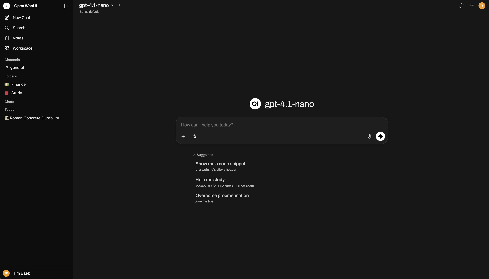

- **What.** [Source] A self-hosted chat UI for "Ollama, OpenAI, Anthropic, or any OpenAI-compatible provider".
  - Model presets under Workspace > Models bundle "System prompts, tools, knowledge, and parameters".
  - It can "Run two models side-by-side and compare responses".
  - Prompts are "Slash-command templates with typed input variables and versioning" ([features](https://docs.openwebui.com/features/)).
- **Evaluation.** [Source] Arena models (off by default since v0.12.0) choose a model at random for blind comparison. A leaderboard ranks models by Elo from user ratings ([evaluation](https://docs.openwebui.com/features/administration/evaluation/)).
  - This is human preference, not an automated scorer, and there is no batch run over a dataset.
- **Status/licence.** [Source] v0.12.3, released 2026-10-16. 156k stars.
  - The licence changed from BSD-3 to the "Open WebUI License" from v0.6.6 (2025-04-19). It adds a branding clause, with an exemption for deployments of 50 or fewer users, and is not OSI-approved ([licence](https://docs.openwebui.com/license/)).
- **Fit.** [Inference] Useful for pasting a rendered system prompt into a model preset and chatting through a position with qwen3.5:9b and gemma3:12b side by side. It cannot send ChessLLM's JSON schema/enum, so the results are only indicative.

#### Ollama's own app

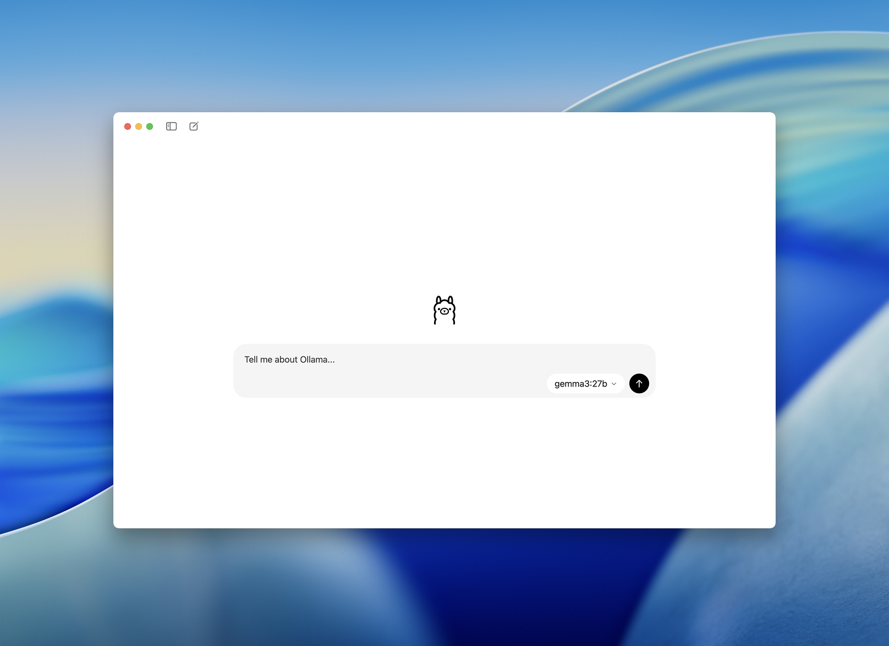

- **What.** [Source] The macOS/Windows app launched on 2025-07-30. It is "an easier way to chat with models", with file drag-and-drop and a context-length setting ([blog](https://ollama.com/blog/new-app)).
  - The post does not mention a system-prompt setting.
- **Fit.** [Inference] Quick smoke tests only.
  - Ollama itself also supports a `SYSTEM` line in a Modelfile, but that bakes the prompt into a model tag. A model tag is part of the Player configuration's `model`, which would muddle Ratings.

#### Msty Studio

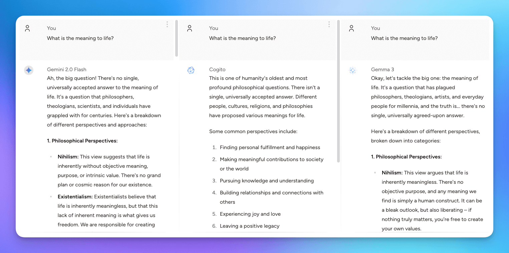

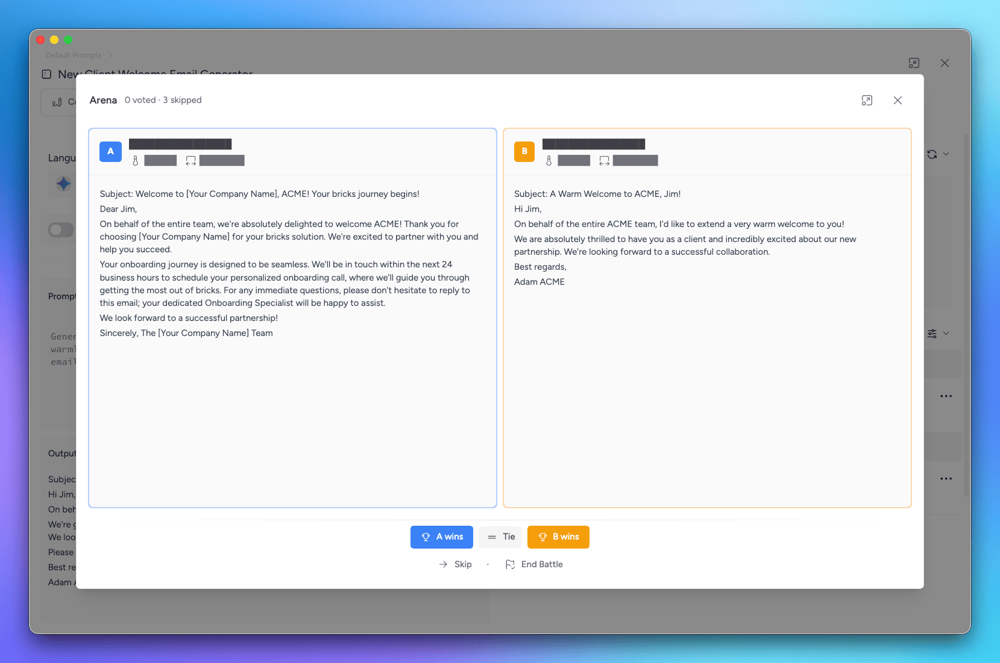

- **What.** [Source] A desktop/web chat app. One Local Models area covers "models running through Ollama, MLX, and Llama.cpp" ([local models](https://docs.msty.ai/studio/managing-models/local-models)).
  - Split Chat lets you "chat with multiple models at once" ([split chat](https://docs.msty.ai/studio/conversations/split-chat)).
  - The Prompt Studio Sandbox runs prompt versions with a system prompt and variable values. Its "Arena" runs selected versions "multiple times, and the one with the best performance will be declared the winner". The Sandbox and versions are an **Aurum** (paid) perk ([prompt studio](https://docs.msty.ai/studio/studios/prompts-studio)).
- **Licence.** [Source] Proprietary. "free to get started" ([docs home](https://docs.msty.ai/)).
- **Fit.** [Inference] It is the nicest manual side-by-side UI, but it has no code scorer and is closed source.

#### LM Studio

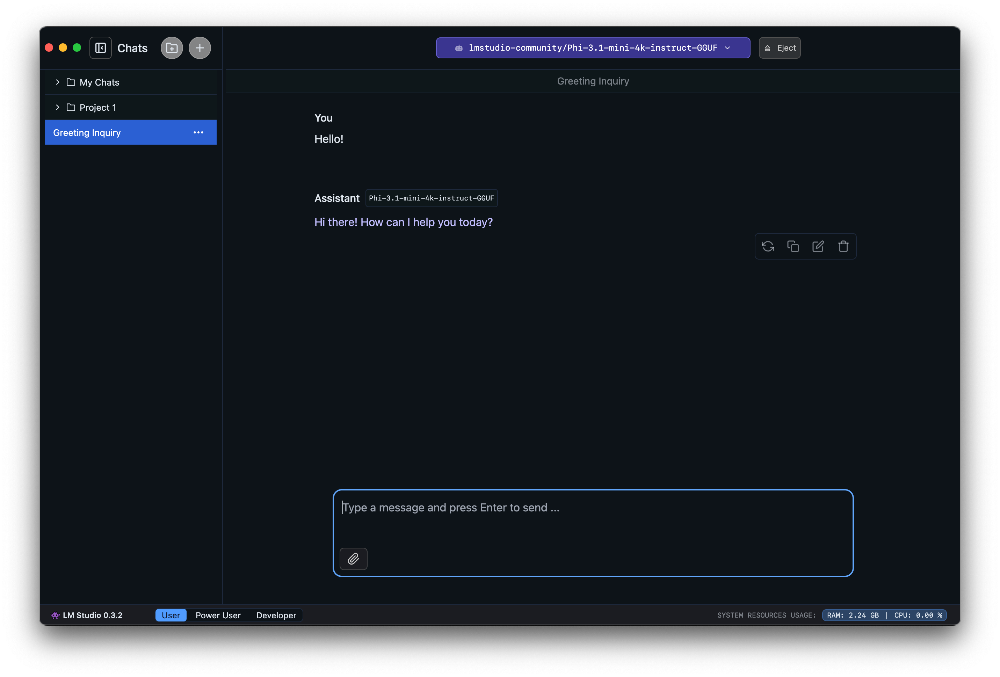

- **What.** [Source] A desktop app with its own llama.cpp and MLX runtimes and an OpenAI-like local server ([docs](https://lmstudio.ai/docs/app)).
- **Licence.** [Source] Proprietary. Free for home and work use since the free-for-work change ([blog](https://lmstudio.ai/blog/free-for-work)).
- **Fit.** [Inference] It does not talk to the Ollama server; it runs its own model files. Results would come from a different runtime and quantisation than the ones ChessLLM rates, so it is not a good fit.

### Prompt evaluation / comparison tools

#### promptfoo

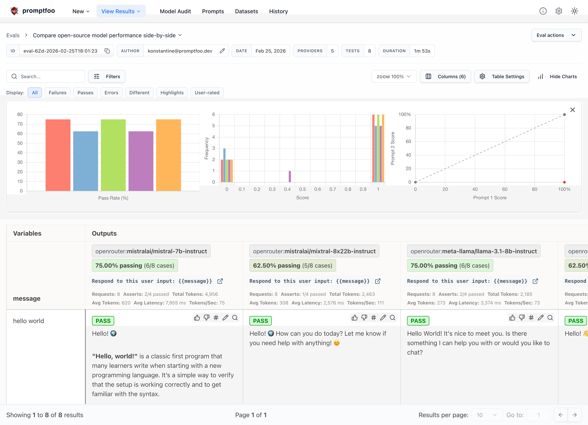

- **What.** [Source] A CLI and local web viewer for prompt/model evals. Install with `npm install -g promptfoo`, `npx promptfoo@latest` or `brew install promptfoo`. Node ≥ 22.22.0 is required ([install](https://www.promptfoo.dev/docs/installation/)).
  - MIT, 26k stars, very active (pushed 2026-10-19).
- **Ollama.** [Source] Configured as `ollama:chat:<model>`.
  - Config keys `think` (also `'low'…'max'` on Ollama 0.34+) and `format` (`json` or a JSON schema), plus `temperature`, `top_p`, `num_predict`, `num_ctx` and `keep_alive`.
  - `passthrough` sends any other Ollama API field.
  - Caveat: "On reasoning models, pair `format` with `think: false`", otherwise the thinking trace is prepended and breaks JSON. Unknown config keys are silently dropped ([Ollama provider](https://www.promptfoo.dev/docs/providers/ollama/)).
- **Prompts.** [Source] Prompts load from `.txt` (several per file, separated by `---`), `.md`, `.j2` (Jinja2), chat-format JSON (system and user messages), or a Python function `file://x.py:fn`. They are rendered with Nunjucks ([prompts](https://www.promptfoo.dev/docs/configuration/prompts/)).
  - [Inference] ChessLLM's `$color` placeholders are not Nunjucks `{{color}}`, so either convert them or let a Python prompt function call `chessllm.prompt.system_prompt()`.
- **Tests.** [Source] `tests: file://positions.csv`: column headers become vars and `__expected` columns become assertions. JSONL is also accepted, and Python test generators (`file://gen.py:create_tests`) return a list of tests ([test cases](https://www.promptfoo.dev/docs/configuration/test-cases/)).
- **Scorers.** [Source] `type: python` assertions, inline or `file://check.py:fn`. The default function is `get_assert(output, context)`, and `context["vars"]` holds the test's variables. It returns a bool, a float score, or a `GradingResult` dict (`pass`, `score`, `reason`, `named_scores`) ([Python assertions](https://www.promptfoo.dev/docs/configuration/expected-outputs/python/)).
  - [Inference] A ~10-line `check.py` can call `chessllm.game.judge(chess.Board(fen), output)` and return named scores for `legal` / `invalid` / `illegal` / `ambiguous`, the same kinds ChessLLM logs.
- **Python provider.** [Source] `providers: [{id: 'file://provider.py', config: {...}}]` with `call_api(prompt, options, context)` returning `{'output': …}`. `context['vars']` is available ([Python provider](https://www.promptfoo.dev/docs/providers/python/)).
  - [Inference] This is the cleanest integration. The provider builds messages with `turn_messages(pgn, fen, color, prompt_file, legal_moves)` and calls `OllamaPlayer(model, thinking, sampling=…).reply(messages, allowed_moves)`, so the eval uses ChessLLM's own schema, thinking flag and Enforced decoding. Promptfoo's `prompts:` entry then carries the path of the prompt-file variant.
- **Ownership.** [Source] OpenAI announced on 2026-03-09 that it would acquire Promptfoo. Both posts say the open-source project continues ([OpenAI](https://openai.com/index/openai-to-acquire-promptfoo/), [promptfoo](https://www.promptfoo.dev/blog/promptfoo-joining-openai/)).
  - [Inference] There is some long-term direction risk, mitigated by the MIT licence.

#### ChainForge

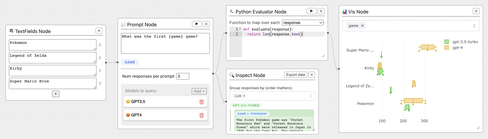

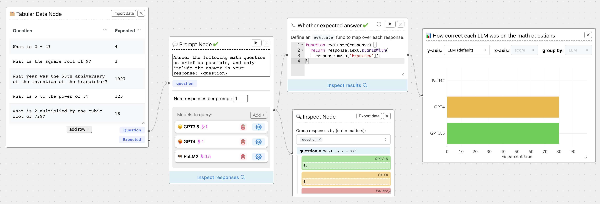

- **What.** [Source] "An open-source visual environment for battle-testing prompts to LLMs". Install with `pip install chainforge` and run `chainforge serve` (Python ≥ 3.10).
  - The local install can "write Python code to evaluate LLM responses, or query locally-run models hosted via Ollama". The web version cannot ([README](https://github.com/ianarawjo/ChainForge)).
  - MIT, 3k stars, v0.3.7 (2026-09-16), commits in October 2026.
- **Features.** [Source] Prompt templates with `{variables}`, Tabular Data nodes for ground-truth comparisons, and evaluation nodes ("Python script based").
  - Visualisation nodes (box plots, histograms) for numeric/boolean metrics.
  - "Compare across settings", e.g. "measure the impact of a system message … by adding several … models, changing individual settings, and nicknaming each one" (README).
- **Ollama settings.** [Source] The Ollama settings form has `system_msg` (chat models only), `format` ("The JSON schema to use for structured outputs"), `temperature`, `num_ctx`, `top_k`, `top_p`, `seed` and `stop_sequences`. There is no `think` field ([ModelSettingSchemas.tsx](https://github.com/ianarawjo/ChainForge/blob/main/chainforge/react-server/src/ModelSettingSchemas.tsx)).
  - [Inference] With qwen3.5:9b this means you cannot turn thinking off or on from ChainForge. You get Ollama's default for the model.
- **Fit.** [Inference] It is the best GUI for "two system prompts × three models × 30 positions → box plot of legality".
  - A position CSV exported from `games/*.jsonl` goes into a Tabular Data node.
  - A Python evaluator using python-chess works if `chess` is installed in the same environment as ChainForge.
  - The prompt text is copied in by hand, so nothing stays in sync with `chessllm/prompts/`.

#### Langfuse

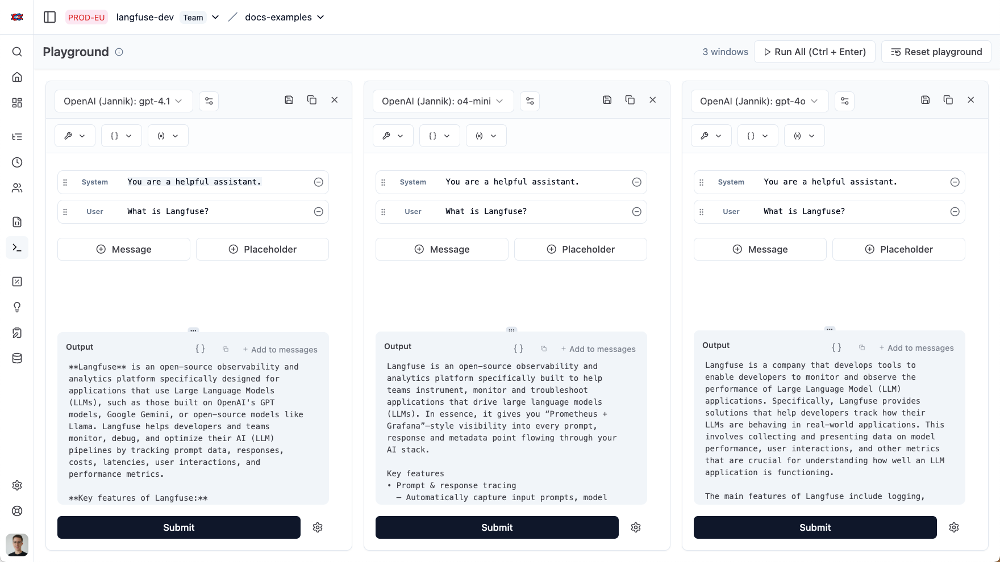

- **What.** [Source] Open-source LLM engineering platform: tracing, prompt management (versions, labels), playground and experiments.
  - The playground can "Compare multiple prompt variants alongside each other", enforce JSON-schema response formats, and save to Prompt Management ([playground](https://langfuse.com/docs/prompt-management/features/playground)).
- **Bulk runs.** [Source] Prompt experiments run a prompt version against a dataset from the UI, with LLM-as-a-judge or code evaluators ([UI experiments](https://langfuse.com/docs/evaluation/experiments/experiments-via-ui)).
  - The Python SDK has `langfuse.run_experiment(name=…, data=…, task=…, evaluators=[fn])`. An evaluator gets `input`, `output`, `expected_output` and `metadata` and returns `Evaluation(name, value, comment)` ([SDK experiments](https://langfuse.com/docs/evaluation/experiments/experiments-via-sdk)).
- **Ollama.** [Source] Any OpenAI-schema endpoint works through the OpenAI provider with a custom base URL.
  - But `localhost`, private IPs and `host.docker.internal` are blocked by an SSRF deny-list. A self-hosted instance must list the host explicitly (`LANGFUSE_LLM_CONNECTION_WHITELISTED_HOST`, etc.). On Langfuse Cloud it is impossible ([LLM connections](https://langfuse.com/docs/administration/llm-connection)).
- **Licence.** [Source] MIT outside the `ee/` directories. "All core Langfuse features and APIs are available in Langfuse OSS … without any limits". Protected prompt labels need a licence key ([licence key](https://langfuse.com/self-hosting/license-key)). v4.64.0, 2026-10-19.
- **Fit.** [Inference] Too heavy for one person's local benchmark: a server and database next to FastAPI. The playground goes through the OpenAI-compatible path, not ChessLLM's `think`/enum request.

#### Arize Phoenix

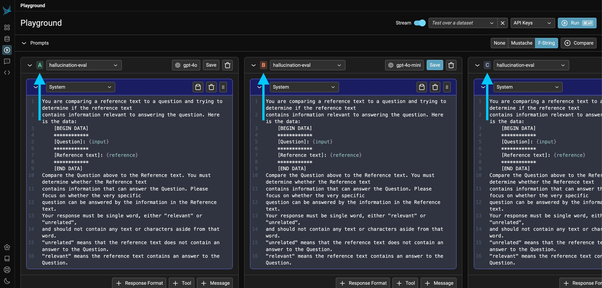

- **What.** [Source] Tracing and evaluation platform with a prompt playground.
  - "+ Compare" creates variants A-D, each with its own template, model and parameters.
  - "Phoenix lets you run a prompt (or multiple prompts) on a dataset", recorded as an experiment ([using the playground](https://arize.com/docs/phoenix/prompt-engineering/how-to-prompts/using-the-playground)).
  - Ollama has been supported in the playground since Phoenix 10.7 (2025-06-04) ([release note](https://github.com/Arize-ai/phoenix/blob/main/docs/phoenix/release-notes/06-2025/06-04-2025-ollama-support-in-playground.mdx)).
- **Licence.** [Source] Elastic License 2.0: free to self-host and use, but you may not offer it as a hosted service ([LICENSE](https://github.com/Arize-ai/phoenix/blob/main/LICENSE)).
- **Fit.** [Inference] It has the best playground-plus-dataset UX of the platforms, at the same deployment cost as Langfuse.

#### Opik (Comet)

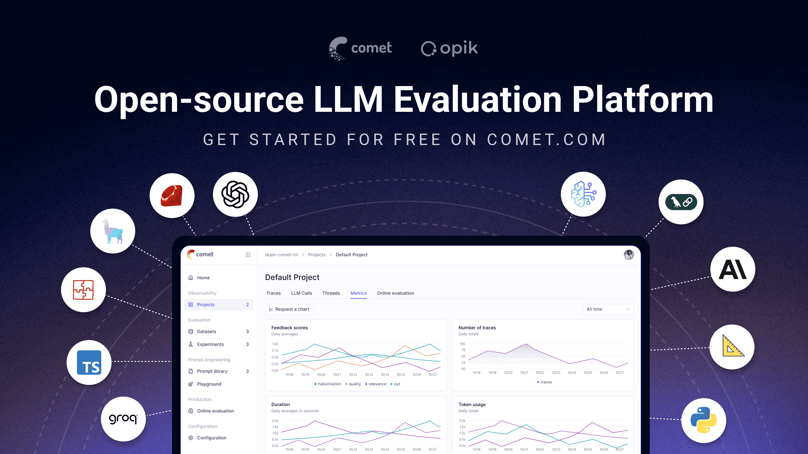

- **What.** [Source] "open-source LLM observability and evaluation platform" with a Prompt Playground, datasets, experiments and an "Agent Optimizer SDK". "Apache-2.0 licensed, free to self-host the full platform" ([README](https://github.com/comet-ml/opik)).
  - I did not verify Ollama support in its playground.
- **Fit.** [Inference] It is the most permissively licensed of the platforms, and the same "too heavy" caveat applies.

#### Agenta

- **Status.** [Source] The README now describes "The open-source workspace for your agents and your team … Build AI coworkers by chatting" ([README](https://github.com/Agenta-AI/agenta)).
  - The prompt-playground/evaluation docs are v1.0, "no longer actively maintained".
  - Those docs describe Ollama as an OpenAI-compatible custom provider with base URL `http://host.docker.internal:11434/v1` ([v1.0 docs](https://agenta.ai/docs/1.0/prompt-engineering/playground/custom-providers)).
- **Fit.** [Inference] Do not adopt it for prompt evaluation in 2026.

#### PromptLayer

- **What.** [Source] Prompt Registry (versions, release labels), Playground and "Tables" for dataset-based evals ([registry](https://docs.promptlayer.com/features/prompt-registry/overview)).
  - Custom base URLs are supported. On-prem is "for a select few of our enterprise customers" ([FAQ](https://docs.promptlayer.com/features/faq)).
- **Fit.** [Inference] It is a SaaS that would have to reach a public endpoint for your Ollama server. Not suitable.
- **Screenshot.** None: the registry docs page contains no images.

#### OpenAI-compatible playgrounds in general

- [Source] Ollama serves an OpenAI-compatible API at `http://localhost:11434/v1/` (chat completions, completions, models, embeddings, responses). It accepts `response_format`, and `reasoning_effort`/`think` for thinking ([OpenAI compatibility](https://docs.ollama.com/api/openai-compatibility)).
  - Any playground that accepts a custom OpenAI base URL can reach it if it runs locally.
- [Inference] The native `/api/chat` call ChessLLM makes (`think` + `format` with an `enum`) maps to `/v1` only loosely. A playground result is a good guide, but it is not the same request.

### Python libraries

#### DSPy

- **What.** [Source] A framework for "programming" LM pipelines, with optimisers ([repo](https://github.com/stanfordnlp/dspy)). MIT, 3.4.1 (2026-10-12).
  - Ollama is configured with `dspy.LM('ollama_chat/llama3.2', api_base='http://localhost:11434', api_key='')` ([LM docs](https://github.com/stanfordnlp/dspy/blob/main/docs/docs/learn/programming/language_models.md)).
  - Since 3.x, LM calls go through a bundled `lm15` engine, and LiteLLM is optional (`dspy[litellm]`) ([pyproject](https://github.com/stanfordnlp/dspy/blob/main/pyproject.toml)).
- **Optimisers.** [Source]
  - Few-shot: `LabeledFewShot`, `BootstrapFewShot`, `BootstrapFewShotWithRandomSearch`, `KNNFewShot`.
  - Instruction: `COPRO`, `MIPROv2`, `SIMBA`, `GEPA`.
  - Also `BootstrapFinetune`, `Ensemble`, `BetterTogether`.
  - Guidance: use `MIPROv2` 0-shot "if you prefer to do instruction optimization only", and give it about 200 examples for long runs ([optimizers](https://github.com/stanfordnlp/dspy/blob/main/docs/docs/learn/optimization/optimizers.md)).
- **Fit.** [Inference] A metric of "1 if `parse_san` succeeds" (or a move-quality score from `chessllm/move_quality.py`) over a few hundred positions from the game logs could let MIPROv2/GEPA *propose* better instructions. The reflection model could be one of the local models.
  - DSPy writes its own prompt layout (field headers, its JSON adapter), so the winning instruction text must be copied back into `system.txt` and re-tested through the real path.
  - It is best kept as a separate research script, not a runtime dependency.

#### LiteLLM, LangChain

- [Source] LiteLLM: `ollama_chat/<model>` is the recommended prefix, and `response_format` with `json_schema` works ([docs](https://docs.litellm.ai/docs/providers/ollama)).
- [Source] LangChain: `ChatOllama` lives in the `langchain-ollama` package and lists structured output as supported ([docs](https://docs.langchain.com/oss/python/integrations/chat/ollama)).
- [Inference] Neither adds evaluation. ChessLLM already calls `ollama` directly with exactly the options it needs, so adding either would be plumbing for its own sake.

#### Templating (Jinja2 vs `string.Template`)

- [Source] Jinja2 3.1.6 (BSD-3) adds conditionals and loops. promptfoo can load `.j2` prompts directly ([promptfoo prompts](https://www.promptfoo.dev/docs/configuration/prompts/)).
- [Inference] The two prompt files differ mainly in whether the legal-move list is described. A Jinja `` could merge them into one template.
  - But `string.Template.substitute` fails loudly on a missing key and cannot run code, which is safer if prompts become user-editable from the browser.
  - Switching is not needed to make prompts editable.

## Where prompt editing could live in ChessLLM

Constraint from CONTEXT.md: the prompt is part of the **Player configuration**, so a changed prompt must be a different configuration, with a separate Rating.

### Prerequisite: identify a prompt by its content

- [Repo] Today `PlayerConfiguration.prompt` is the file name (`chessllm/leaderboard.py`), and the game log records the absolute path (`prompt_file`/`prompt_files` in `game.py`, about line 267).
- [Inference] The fix has three parts.
  - Log the **prompt text**, or its SHA-256, in `game_start`.
  - Make `PlayerConfiguration.prompt` a `name@hash8` pair (or the hash alone), built in `llm_configuration` and `settings_configuration`.
  - Old logs only have a path. They can keep their file-name identity, or be mapped to the hash of the file as it was at a known commit.
- This has to come before any editing UI, or Ratings mix prompts silently. It is ADR-worthy, since it touches ADR 0004 (game log v2) and ADR 0005 (rating).

### Option A: named prompt files, chosen per side (recommended first step)

- `chessllm/prompts/` becomes a small library, for example `system.txt`, `system_listed.txt`, `free-terse.txt`, `listed-fewshot.txt`.
- `LlmSide` (`chessllm/game.py`) gets a `prompt: str | None` field; `None` means the default per LLM constraints, as today.
- `prompt.py` resolves it in place of `SYSTEM_PROMPT_FILES[...]`, and validates the placeholders with `Template(...).substitute` on a dummy board at game start.
- `GET /api/models` (or a new `GET /api/prompts`) lists the files. The Settings modal (`frontend/src/settings/SettingsModal.tsx`, `next-game.ts`) gets a select box per LLM side.
- Editing happens in the user's editor, in git.
- Trade-offs:
  - Prompts stay versioned and reviewable, and the same files feed promptfoo.
  - No in-browser editing, and the user must remember not to edit a file that already has rated games. The hash prerequisite makes that safe: an edit simply creates a new configuration.

### Option B: edit the prompt in the Settings modal

- A textarea in the Settings modal, prefilled from the selected file, with a "Save as new prompt" action that writes a new file under `chessllm/prompts/` (never overwriting one in use).
- Or keep it in-memory per game: the full text goes in `POST /api/games` and is logged in `game_start`.
- Trade-offs:
  - Fastest loop for "change a word, play a game".
  - It needs server-side placeholder validation, a write endpoint, and care that the Analytics page shows which prompt a configuration used. Without a diff/preview, prompts multiply in the leaderboard.

### Option C: an offline prompt-eval harness (complements A)

A new `evals/` (or `scripts/prompt_eval/`) directory with:
- `export_positions.py`: reads `games/*.jsonl` `llm_attempt` lines (`pgn`, `fen`, colour from the ply) and writes `positions.csv`, optionally deduplicated and stratified by game phase.
- `provider.py`: a promptfoo Python provider that calls `chessllm.prompt.turn_messages` and `chessllm.ollama_player.OllamaPlayer` with the variant's file, model, thinking and LLM constraints.
- `check.py`: a promptfoo assertion that parses the JSON and classifies the move with python-chess, reusing `chessllm.game.judge(board, raw)` so the kinds match the game log (`legal`, `invalid`, `illegal`, `ambiguous`). It returns `named_scores`.
- `promptfooconfig.yaml`: prompt files × models × positions. Run with `npx promptfoo@latest eval` and view with `promptfoo view`.

Trade-offs:
- It measures legality and format on hundreds of positions in minutes, without playing games or touching Ratings.
- It adds a Node tool to a Python/uv repo, and it measures single-move behaviour, not game strength. Rated games are still the only source of a Rating.

## Recommendation

1. **promptfoo** for bulk, repeatable comparison of prompt variants on positions from the game logs, with a Python provider that reuses `turn_messages` and `OllamaPlayer`, and a python-chess assertion. It is the only tool checked that is local, open source, scriptable, scores with code, and can drive ChessLLM's exact Ollama request.
2. **ChainForge** as an optional visual sandbox for early wording experiments across the three models. Accept that it cannot toggle `think` and does not read the repo's prompt files.

For ChessLLM itself:
- First make the prompt's content part of the Player configuration's identity (hash in the game log and in `PlayerConfiguration.prompt`).
- Then do Option A (named prompt files, a per-side select in the Settings modal), with Option C as the evaluation loop.
- Leave in-browser editing (Option B) until the hash identity and a prompt column on the Analytics page exist.
- Skip the LLMOps platforms (Langfuse, Phoenix, Opik) unless the project later needs tracing across many runs. They are heavyweight, and none of their playgrounds sends ChessLLM's `think` + enum request as-is.

## Screenshots

All images were downloaded from the tool's official README or docs on 2026-10-19:

| File | Source |
|---|---|
| `img/prompt-tooling/open-webui.png` | Open WebUI README `demo.png` |
| `img/prompt-tooling/ollama-app.png` | ollama.com/blog/new-app (`files.ollama.com/ollama-app-screenshot.png`) |
| `img/prompt-tooling/msty.png` | docs.msty.ai Split Chat page |
| `img/prompt-tooling/msty-prompt-sandbox.png` | docs.msty.ai Prompt Studio page |
| `img/prompt-tooling/lm-studio.png` | lmstudio.ai/docs/app/basics (older 0.3.2 UI) |
| `img/prompt-tooling/promptfoo.png` | promptfoo README (`site/static/img/claude-vs-gpt-example@2x.png`) |
| `img/prompt-tooling/chainforge.png`, `chainforge-ground-truth.png` | ChainForge README |
| `img/prompt-tooling/langfuse.png` | langfuse.com playground docs (`playground-overview.png`) |
| `img/prompt-tooling/phoenix.jpeg` | Phoenix "Using the playground" docs |
| `img/prompt-tooling/opik.png` | Opik README thumbnail |
| `img/prompt-tooling/agenta.png` | Agenta README product-tour image (current product, not the old playground) |

No screenshots for:
- PromptLayer: the docs page had none.
- DSPy: the README has only a logo.
- LiteLLM, LangChain, Jinja2: libraries with no UI.
